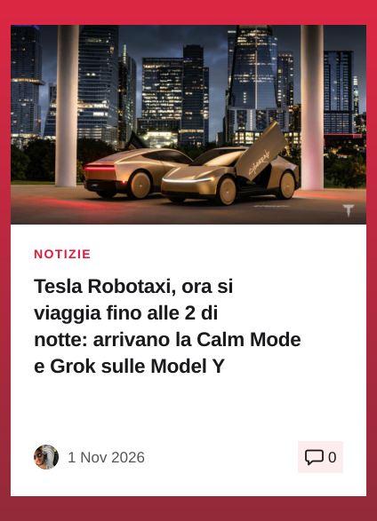
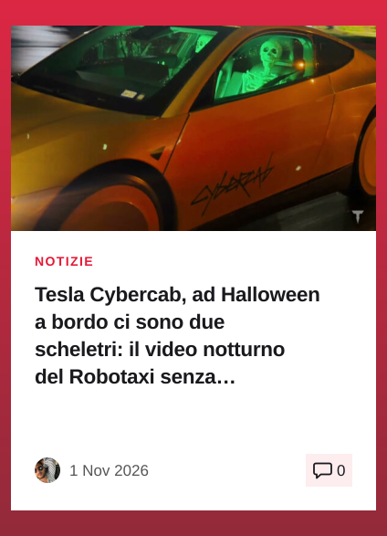
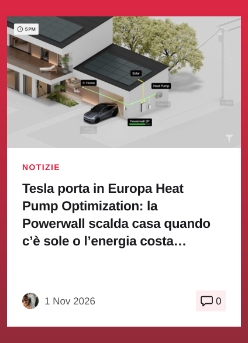

<p align="center">
  
</p>

<p align="center">
  <a href="https://www.instagram.com/emanuele_tech"></a>
  <a href="https://www.youtube.com/@emanuele_tech"></a>
  <a href="https://t.me/emanueletech"></a>
  <a href="https://www.teslers.it"></a>
  <a href="https://makerworld.com/en/@Emanuele_tech"></a>
  <a href="https://linktr.ee/emanuele_tech"></a>
</p>

---

```js
const emanuele = {
  brand:    "Emanuele Tech",
  based:    "Rome, Italy 🇮🇹",
  topics:   ["3D printing", "AI", "EVs"],
  building: ["maker tools", "Telegram bots", "games"],
  printing: "Bambu Lab · MakerWorld creator",
  editor:   "teslers.it",
};
```

### 📺 Latest videos

<!-- YOUTUBE:START -->
<p align="center">
<a href="https://www.youtube.com/watch?v=e2BgM6dzuwM" title="3D-Printing Christmas Gift Box"></a>
<a href="https://www.youtube.com/watch?v=P0iMwKdpltY" title="3D-Printing Rising Skeleton Coffin"></a>
<a href="https://www.youtube.com/watch?v=LT0_fgVeSVg" title="3D-Printing Pokéball Coin Holder Card - 30th Anniversary Coin"></a>
<a href="https://www.youtube.com/watch?v=PdItYy4OPpk" title="3D-Printing Pokémon Graded Card Stand"></a>
<a href="https://www.youtube.com/watch?v=2Rz5EJSSzvA" title="3D-Printing Spider-Man"></a>
<a href="https://www.youtube.com/watch?v=mz2Ym5uObqw" title="3D-Printing Hyper Hopper"></a>
</p>
<!-- YOUTUBE:END -->

### 📰 Latest on [Teslers.it](https://www.teslers.it)

I run **Teslers.it**, an Italian news site about Tesla and electric vehicles.

<!-- TESLERS:START -->
<p align="center"><a href="https://www.teslers.it/14657/tesla-robotaxi-orari-2-notte-calm-mode-grok" title="Tesla Robotaxi, ora si viaggia fino alle 2 di notte: arrivano la Calm Mode e Grok sulle Model Y"></a><a href="https://www.teslers.it/14718/tesla-cybercab-halloween-scheletri-video-robotaxi" title="Tesla Cybercab, ad Halloween a bordo ci sono due scheletri: il video notturno del Robotaxi senza conducente"></a><a href="https://www.teslers.it/14666/tesla-powerwall-3-heat-pump-optimization-europa-pompa-calore" title="Tesla porta in Europa Heat Pump Optimization: la Powerwall scalda casa quando c’è sole o l’energia costa meno"></a></p>
<!-- TESLERS:END -->

### 🛠️ Projects

#### 🧮 [3d-print-cost](https://github.com/emanueletech/3d-print-cost)
    

Desktop app that reads your `.3mf` files and gives you print time, filament use and the **real cost** of every 3D print.

#### 📊 [makerpulse](https://github.com/emanueletech/makerpulse)
  

Browser extension for MakerWorld creators: stats, points, gift cards, review filters and quick replies.

#### 🎬 yoink — Telegram media bot &nbsp; <a href="https://t.me/yoinkvideobot"></a>
    

Send a social link, get the video back ready to save to your iPhone camera roll. 1,700+ supported sites, automatic H.264 transcoding, quality picker, photo albums and carousels, Telegram Stars credits. Self-hosted on a NAS.

#### 🎮 [game-off-2026](https://github.com/emanueletech/game-off-2026)
  

My entry for GitHub Game Off 2026: a browser game, playable on itch.io.

### 🧰 Tech stack

<p align="left">
  
</p>

### 📈 Stats

<p align="center">
  <picture>
    <source media="(prefers-color-scheme: dark)" srcset="assets/stats-dark.svg" />
    
  </picture>
</p>

<p align="center">
  <picture>
    <source media="(prefers-color-scheme: dark)" srcset="assets/snake-dark.svg" />
    
  </picture>
</p>

<p align="center"><sub>⭐ If one of my tools saves you time, a star helps other makers find it.</sub></p>
